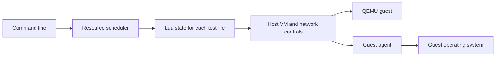

Provium runs tests that need an operating system of their own. You write Lua
tests, choose a guest profile, and ask Provium to start virtual machines
(VMs). A guest agent carries out commands and file operations inside them.

Use Provium when a test needs to observe a boot, coordinate several guests, or
change a guest's disks, network, or clock. Keep tests of isolated program
logic in the component's ordinary unit-test suite.

## How a run works

The command `provium tests/` discovers files ending in `.test.lua`. Each file
gets a Lua state and a resource scope called a lab. The scheduler limits how
many files run together according to their resource claims.

Within a file, `test(...)` calls run in order. Each test has a child scope for
resources created inside its body. A VM created at file scope can be shared by
that file's tests. A VM created inside a test belongs to that test. See
[labs and scope](~provium/writing-tests/labs-and-scope).

The QEMU backend boots an explicitly selected kernel and initrd. Host and
guest communicate through a virtual socket, or vsock. The guest kernel must
support that transport and the image must support the agent's startup path.
Provium 0.1.0 accepts the `peios` guest profile type; an arbitrary
operating-system image is not a supported substitute.

## Test resources

A VM exposes guest commands, files, processes, console output, and clock
controls. Separate worker processes allow a test to use different guest
credentials. These operations affect the test guest.

Bridges connect guests at the Ethernet layer. Tests configure addresses inside
the guests and can apply latency, packet loss, or bandwidth limits on the
host. These features require host network access. Disk tests can attach images
and inject selected I/O faults.

Fixtures store snapshots for reuse. A fixture's source, dependencies, and
profile inputs contribute to its cache identity. Reusing a snapshot avoids
repeating its setup; it does not replace checking that the fixture models the
state the test needs.

## Results and limits

Provium reports passed, failed, and skipped tests. It can also write a
structured event stream for tools such as `provium-coverage`. The event stream
describes harness activity; it is not compiler line coverage.

The local backend is for developing the runner without starting QEMU. Its
operations run on the host. Do not use a local run as evidence that a kernel,
boot path, or guest integration works.

Provium drives guest operations and console streams. It does not provide a
graphical application test framework or a system image builder.
